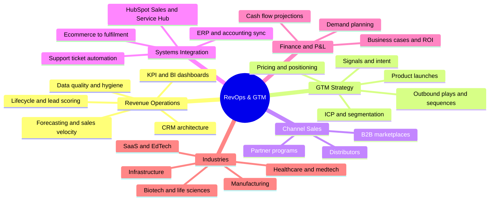
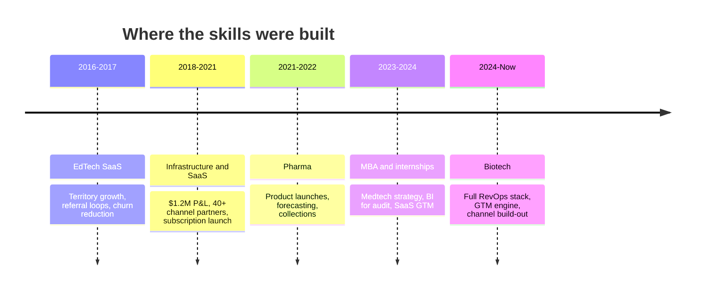
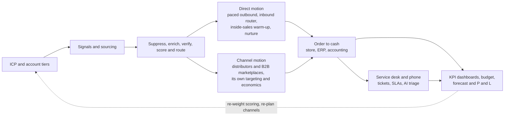

# Rishabh Banola | Revenue Operations & GTM

MBA (STEM, Business Analytics) · 8+ years across biotech, SaaS, EdTech, healthcare, manufacturing and infrastructure.
I build the systems behind revenue: CRM architecture, lead gen, outbound GTM, channel sales, forecasting, KPI reporting and P&L.

> **All data in these repositories is synthetic.** The fictional company is **Aurelis Life Sciences**. Real employers, customers, prices and contacts never appear here. Only the methods, structures and logic come from real work.

---

## Highlights

Illustrative results from the synthetic projects below. Each links to the full write-up, diagrams, data and a script that regenerates it.

| Area | What it shows | Headline result |
|---|---|---|
| Lead scoring | Engagement-only score replaced by fit + engagement + intent, back-tested | MQL buy rate 3.3% to 11.2%; ranking power (AUC) 0.58 to 0.73 |
| CRM data | Marketing-tier cleanup and a clean segment field | Tier 94% full to 58%; classified contacts 55% to 88% |
| Service desk | Ticketing, phone menu, SLAs, AI triage, loop guardrails | First-response SLA met 29% to 88%; 92% of tickets auto-routed at 99% accuracy |
| Systems | Six-layer lead-to-cash architecture with a 12-connection register | Deal-won to invoice 7.8 to 4.4 days; order exceptions 19% to 5% |
| Pricing | Four-method shipping cost analysis with Monte Carlo | All methods agree near $211 a shipment against a $100 charge; zone tiers cut below-cost shipments 55% to 33% |
| Channel | Distributor scorecard, marketplace feeds, duplicate and discrepancy checks | Channel share planned from 2% to 21% of revenue; 5 listing errors caught before launch |
| Voice of customer | Capture standard and post-event dashboard across six events | Stem cell summit turned 52% of VOC entries into leads and 15% into deals; webinars 20% and 3% |
| Pipeline | Stage conversion, ageing, coverage and a CRM-as-a-factory utilisation model | Coverage 2.4x against a 3x target; only 40% of CRM records ever worked, 2% won |
| Events | Full-cost trade show model with repeat, change or drop rule | Best shows return $1.7 to $2.0 gross profit per $1; weakest $0.4 to $0.7 |
| Data governance | CRM migration with reconciliation, quality score and tested backups | Data-quality score 69% to 92%; 250 silently missing records caught and reloaded |
| Partners | Onboarding steps, partner scorecard and cross-partner catalog audit | 27% of listings mismatched the master; government marketplace onboarding about twice as long |
| Planning | Reverse-funnel lead plan, budget, driver-based forecast, cash flow | Plan versus actual by channel; scenarios from -15% close rate to +10% pipeline |
| Outbound | Suppress-first lead pilot and send discipline | 473 usable leads vs 128 for the same budget; 38 sends per reply vs 947 |

## Experience map

## Career timeline

## Skills by domain

| Domain | What I do | Tools |
|---|---|---|
| RevOps | Funnel design, scoring, routing, forecasting, reporting | HubSpot, Salesforce, Power BI, Tableau |
| GTM | ICP, outbound plays, sequences, signal-based prospecting | HubSpot, Clay, LinkedIn |
| Channel | Distributor and marketplace programs, partner onboarding | B2B platforms, pricing sheets |
| Systems | CRM to order to invoice integration, support automation | HubSpot, Fishbowl, QuickBooks, WooCommerce |
| Analytics | KPI frameworks, dashboards, data quality monitoring | Power BI, Alteryx, Python, SQL |
| Quality | Process improvement | Six Sigma Green Belt |

## Projects

### [RevOps-Portfolio](https://github.com/rbanola1/RevOps-Portfolio): revenue operations
| # | Project | What it shows |
|---|---|---|
| 01 | [Sales KPI dashboard](https://github.com/rbanola1/RevOps-Portfolio/tree/main/01-sales-kpi-dashboard) | Executive and weekly team reporting, KPI definitions, funnel and forecast views |
| 02 | [CRM cleanup, segmentation and scoring](https://github.com/rbanola1/RevOps-Portfolio/tree/main/02-crm-cleanup-and-scoring) | Marketing-tier audit, clean segment field, lead score with decay |
| 03 | [Lead generation plan](https://github.com/rbanola1/RevOps-Portfolio/tree/main/03-lead-gen-plan) | Reverse-funnel revenue model, channel ROI, plan versus actual |
| 04 | [Channel sales](https://github.com/rbanola1/RevOps-Portfolio/tree/main/04-channel-sales) | Distributor scorecard, marketplace feeds and duplicate checks, channel economics |
| 05 | [Shipping cost optimization](https://github.com/rbanola1/RevOps-Portfolio/tree/main/05-shipping-cost-simulation) | Monte Carlo pricing analysis and recommendation |
| 06 | [Service Hub, phone lines and AI support agents](https://github.com/rbanola1/RevOps-Portfolio/tree/main/06-service-hub-and-support-agents) | Ticketing, SLAs, phone menu, refund process, loop guardrails, AI triage |
| 07 | [Commercial systems architecture: lead to cash](https://github.com/rbanola1/RevOps-Portfolio/tree/main/07-commercial-systems-architecture) | Six-layer system map, integration register, data ownership, channel order path, reconciliation |
| 08 | [Budget, forecast and P&L](https://github.com/rbanola1/RevOps-Portfolio/tree/main/08-budget-forecast-pnl) | Variance analysis, driver-based forecast, cash flow, scenarios |
| 09 | [Lead ownership and the warm-lead model](https://github.com/rbanola1/RevOps-Portfolio/tree/main/09-sales-model-and-lead-ownership) | Territory rules, research-first check, association labels |
| 10 | [Voice of customer program](https://github.com/rbanola1/RevOps-Portfolio/tree/main/10-voice-of-customer-program) | Feedback capture standard, tagging, post-trade-show dashboard, action loop |
| 11 | [Pipeline health and the CRM as a factory](https://github.com/rbanola1/RevOps-Portfolio/tree/main/11-pipeline-health-analysis) | Stage conversion, coverage, stalled deals, idle-inventory model, weekly review |
| 12 | [Trade show budget and return](https://github.com/rbanola1/RevOps-Portfolio/tree/main/12-tradeshow-budget-and-return) | Full event cost, cost per lead, gross-profit return, repeat or drop scorecard |
| 13 | [CRM migration and data governance](https://github.com/rbanola1/RevOps-Portfolio/tree/main/13-crm-migration-and-data-governance) | Migration plan, reconciliation, quality score, ownership rules, backup and restore |
| 14 | [Partner onboarding and pricing governance](https://github.com/rbanola1/RevOps-Portfolio/tree/main/14-partner-onboarding-and-pricing-governance) | Onboarding steps, partner scorecard, master pricing sheet, catalog audit |

### [GTM-Strategy](https://github.com/rbanola1/GTM-Strategy): go-to-market engine
| # | Project | What it shows |
|---|---|---|
| 01 | [Signal-based outbound GTM engine](https://github.com/rbanola1/GTM-Strategy/tree/main/01-outbound-gtm-engine) | Three-engine architecture, fit x intent routing, guardrails |
| 02 | [Lead scoring redesign](https://github.com/rbanola1/GTM-Strategy/tree/main/02-lead-scoring-redesign) | Back-tested score and lifecycle definitions |
| 03 | [ICP, tiers and nurture](https://github.com/rbanola1/GTM-Strategy/tree/main/03-icp-and-nurture) | ICP cards from won deals, account tiers, nurture tracks |
| 04 | [Net-new lead generation pilot](https://github.com/rbanola1/GTM-Strategy/tree/main/04-net-new-lead-gen-pilot) | Suppress-first, tier-first enrichment, cost control, reply forecast |
| 05 | [Sequence discipline](https://github.com/rbanola1/GTM-Strategy/tree/main/05-sequence-discipline) | Pacing, stop rule, targeted versus bulk |
| 06 | [GTM tool stack](https://github.com/rbanola1/GTM-Strategy/tree/main/06-tool-stack) | Weighted evaluation and stage-gated spend |

### [SixSigma_Green_Belt](https://github.com/rbanola1/SixSigma_Green_Belt)
Green Belt project on US refractory products.

## How the work fits together: one GTM engine, two routes to market

Direct and channel are separate go-to-market motions. They share one data foundation (a single CRM as the source of truth, with agreed ownership of every field) and meet again at order to cash, support and reporting.

## Contact

Cleveland, OH · [LinkedIn](https://www.linkedin.com/in/rishabh-banola/) · rbanola1@gmail.com · open to RevOps, Commercial Operations and GTM roles.
