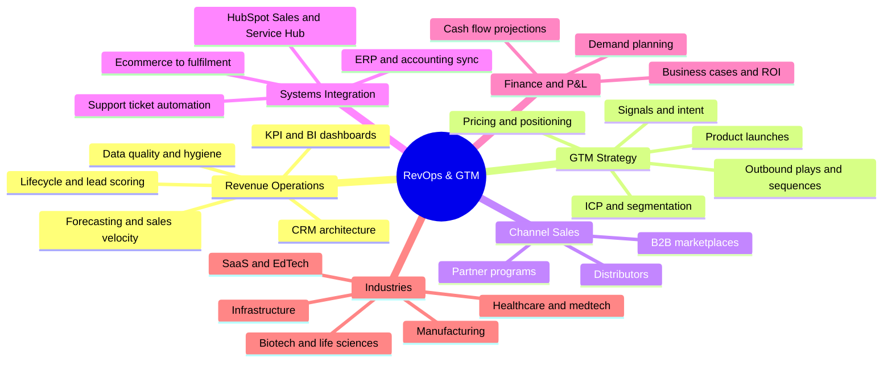
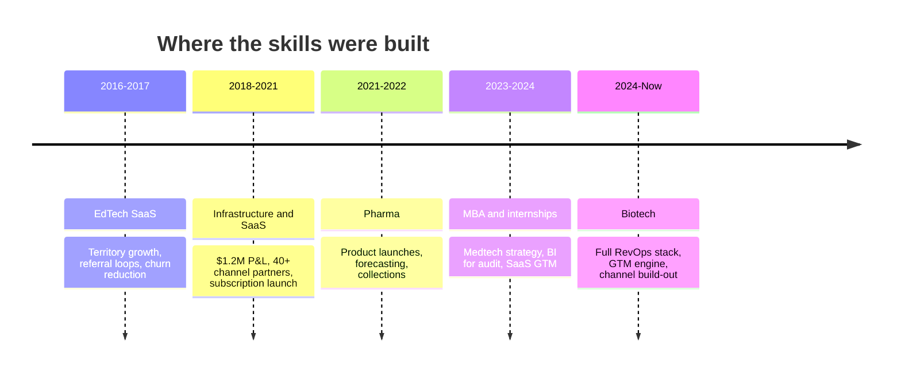
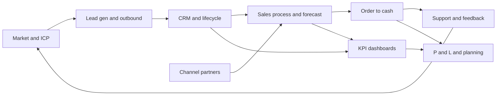

# Rishabh Banola | Revenue Operations & GTM

MBA (STEM, Business Analytics) · 8+ years across biotech, SaaS, EdTech, healthcare, manufacturing and infrastructure.
I build the systems behind revenue: CRM architecture, lead gen, outbound GTM, channel sales, forecasting, KPI reporting and P&L.

> **All data in these repositories is synthetic.** The fictional company is **Aurelis Life Sciences**. Real employers, customers, prices and contacts never appear here. Only the methods, structures and logic come from real work.

---

## Experience map

## Career timeline

## Skills by domain

| Domain | What I do | Tools |
|---|---|---|
| RevOps | Funnel design, scoring, routing, forecasting, reporting | HubSpot, Salesforce, Power BI, Tableau |
| GTM | ICP, outbound plays, sequences, signal-based prospecting | HubSpot, Clay, LinkedIn |
| Channel | Distributor and marketplace programs, partner onboarding | B2B platforms, pricing sheets |
| Systems | CRM to order to invoice integration, support automation | HubSpot, Fishbowl, QuickBooks, WooCommerce |
| Analytics | KPI frameworks, dashboards, data quality monitoring | Power BI, Alteryx, Python, SQL |
| Quality | Process improvement | Six Sigma Green Belt |

## Repositories

| Repo | What it shows | Status |
|---|---|---|
| [RevOps-Portfolio](https://github.com/rbanola1/RevOps-Portfolio) | KPI dashboards, CRM and lead scoring, lead gen, channel sales, systems architecture, P&L | Project 01 live, more coming |
| GTM-Strategy (coming next) | Outbound GTM engine, plays, signal model, tool stack | In progress |
| [SixSigma_Green_Belt](https://github.com/rbanola1/SixSigma_Green_Belt) | Green Belt project, US refractory products | Complete |

## How the work fits together

## Contact

Cleveland, OH · rbanola1@gmail.com · open to RevOps, Commercial Operations and GTM roles.
