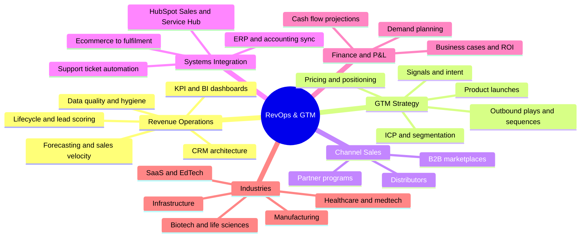
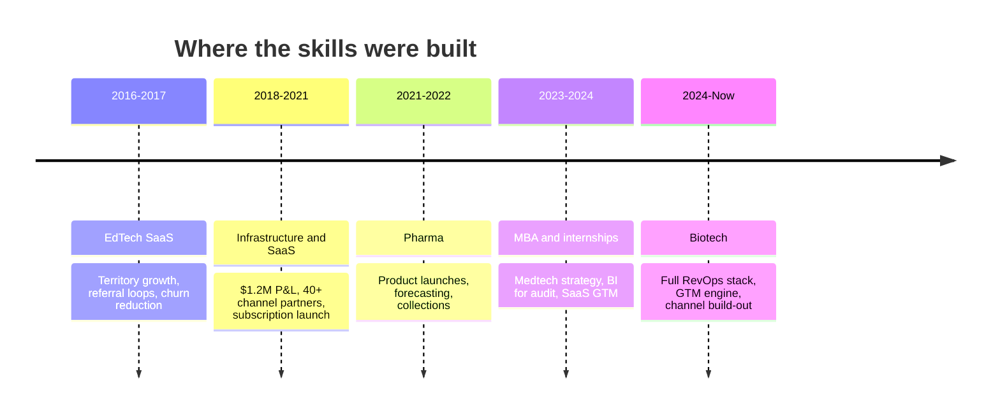
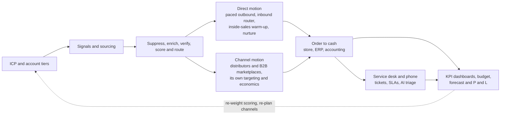

# Rishabh Banola | Revenue Operations & GTM

MBA (STEM, Business Analytics) · 8+ years across biotech, SaaS, EdTech, healthcare, manufacturing and infrastructure.
I build the systems behind revenue: CRM architecture, lead gen, outbound GTM, channel sales, forecasting, KPI reporting and P&L.

> **All data in these repositories is synthetic.** The fictional company is **Aurelis Life Sciences**. Real employers, customers, prices and contacts never appear here. Only the methods, structures and logic come from real work.

---

## Experience map

## Career timeline

## Skills by domain

| Domain | What I do | Tools |
|---|---|---|
| RevOps | Funnel design, scoring, routing, forecasting, reporting | HubSpot, Salesforce, Power BI, Tableau |
| GTM | ICP, outbound plays, sequences, signal-based prospecting | HubSpot, Clay, LinkedIn |
| Channel | Distributor and marketplace programs, partner onboarding | B2B platforms, pricing sheets |
| Systems | CRM to order to invoice integration, support automation | HubSpot, Fishbowl, QuickBooks, WooCommerce |
| Analytics | KPI frameworks, dashboards, data quality monitoring | Power BI, Alteryx, Python, SQL |
| Quality | Process improvement | Six Sigma Green Belt |

## Projects

### [RevOps-Portfolio](https://github.com/rbanola1/RevOps-Portfolio): revenue operations
| # | Project | What it shows |
|---|---|---|
| 01 | [Sales KPI dashboard](https://github.com/rbanola1/RevOps-Portfolio/tree/main/01-sales-kpi-dashboard) | Executive and weekly team reporting, KPI definitions, funnel and forecast views |
| 02 | [CRM cleanup, segmentation and scoring](https://github.com/rbanola1/RevOps-Portfolio/tree/main/02-crm-cleanup-and-scoring) | Marketing-tier audit, clean segment field, lead score with decay |
| 03 | [Lead generation plan](https://github.com/rbanola1/RevOps-Portfolio/tree/main/03-lead-gen-plan) | Reverse-funnel revenue model, channel ROI, plan versus actual |
| 04 | [Channel sales](https://github.com/rbanola1/RevOps-Portfolio/tree/main/04-channel-sales) | Distributor scorecard, marketplace feeds and duplicate checks, channel economics |
| 05 | [Shipping cost optimization](https://github.com/rbanola1/RevOps-Portfolio/tree/main/05-shipping-cost-simulation) | Monte Carlo pricing analysis and recommendation |
| 06 | [Service Hub, phone lines and AI support agents](https://github.com/rbanola1/RevOps-Portfolio/tree/main/06-service-hub-and-support-agents) | Ticketing, SLAs, phone menu, refund process, loop guardrails, AI triage |
| 07 | [Order-to-cash architecture](https://github.com/rbanola1/RevOps-Portfolio/tree/main/07-order-to-cash-architecture) | System map, data ownership, reconciliation |
| 08 | [Budget, forecast and P&L](https://github.com/rbanola1/RevOps-Portfolio/tree/main/08-budget-forecast-pnl) | Variance analysis, driver-based forecast, cash flow, scenarios |
| 09 | [Lead ownership and the warm-lead model](https://github.com/rbanola1/RevOps-Portfolio/tree/main/09-sales-model-and-lead-ownership) | Territory rules, research-first check, association labels |

### [GTM-Strategy](https://github.com/rbanola1/GTM-Strategy): go-to-market engine
| # | Project | What it shows |
|---|---|---|
| 01 | [Signal-based outbound GTM engine](https://github.com/rbanola1/GTM-Strategy/tree/main/01-outbound-gtm-engine) | Three-engine architecture, fit x intent routing, guardrails |
| 02 | [Lead scoring redesign](https://github.com/rbanola1/GTM-Strategy/tree/main/02-lead-scoring-redesign) | Back-tested score and lifecycle definitions |
| 03 | [ICP, tiers and nurture](https://github.com/rbanola1/GTM-Strategy/tree/main/03-icp-and-nurture) | ICP cards from won deals, account tiers, nurture tracks |
| 04 | [Net-new lead generation pilot](https://github.com/rbanola1/GTM-Strategy/tree/main/04-net-new-lead-gen-pilot) | Suppress-first, tier-first enrichment, cost control, reply forecast |
| 05 | [Sequence discipline](https://github.com/rbanola1/GTM-Strategy/tree/main/05-sequence-discipline) | Pacing, stop rule, targeted versus bulk |
| 06 | [GTM tool stack](https://github.com/rbanola1/GTM-Strategy/tree/main/06-tool-stack) | Weighted evaluation and stage-gated spend |

### [SixSigma_Green_Belt](https://github.com/rbanola1/SixSigma_Green_Belt)
Green Belt project on US refractory products.

## How the work fits together: one GTM engine, two routes to market

Direct and channel are separate go-to-market motions. They share one data foundation (a single CRM as the source of truth, with agreed ownership of every field) and meet again at order to cash, support and reporting.

## Contact

Cleveland, OH · rbanola1@gmail.com · open to RevOps, Commercial Operations and GTM roles.
